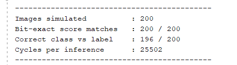

# INT8 Neural Network Inference Accelerator in Verilog (MNIST)

An INT8-quantized neural network for handwritten-digit recognition, trained in PyTorch and implemented as a Verilog inference core. The core is verified **bit-exact** against a Python integer golden model in Vivado simulation, and synthesized and implemented for the Artix-7 `xc7a35tcpg236-1` (the Basys3 chip).

> **Scope:** verified in simulation, synthesized and implemented in Vivado (out-of-context mode). It has **not** been run on a physical FPGA board.

## Results

| Item | Result |
|---|---|
| Model | 784-32-10 MLP, MNIST |
| Float accuracy | 96.11% (10,000 test images, Python) |
| INT8 accuracy | 96.13% (10,000 test images, Python integer model) |
| RTL verification | 200 / 200 test images bit-exact (all 10 output scores per image) vs Python golden model |
| Class vs label on those 200 | 196 / 200 (same as the Python model) |
| Clock | 62.5 MHz (16 ns), timing met, WNS +0.474 ns |
| Cycles per inference | 25,502 |
| Latency | about 408 µs per image |
| Slice LUTs | 579 (2.78%) |
| Slice registers | 440 (1.06%) |
| Block RAM | 9 tiles (18%) |
| DSP blocks | 0 |
| Power (estimated) | 0.082 W (0.013 W dynamic, 0.069 W static; Vivado confidence: medium) |

Timing history for the same design: at a 10 ns clock the setup check failed (WNS -3.776 ns); at 14 ns it failed (WNS -0.755 ns); at 16 ns it passes (WNS +0.474 ns). The slowest path is most likely the per-neuron finishing step (bias add, 48-bit multiply by the requantization constant, shift and clamp in one cycle).

Evidence files are in [`reports/`](reports): `utilization.txt`, `timing.txt`, `power.txt`, and the simulation result screenshot.



## How it works

1. **Train** (`python/train.py`): a 784-32-10 MLP (ReLU) on MNIST, 10 epochs, Adam.
2. **Quantize** (`python/quantize.py`): symmetric INT8 weights per layer, INT32 biases, inputs scaled to 0..127. The hidden layer is requantized with an integer multiplier and shift (`M1_INT = 6705`, `SHIFT = 24`) with rounding and a clamp to 0..127 that doubles as the ReLU. The output layer keeps INT32 scores and takes the argmax. The whole forward pass uses integer arithmetic only, which makes it the golden model.
3. **Export** (`python/export.py`): weights and biases as `.mem` files, 200 test images, and the golden scores for each.
4. **RTL** (`rtl/nn_core.v`): one shared signed 8x8 MAC, an FSM (RUN, FLUSH, FIN, ARGMAX, DONE), synchronous-read weight ROMs that map to block RAM, and a 48-bit requantization product.
5. **Verify** (`tb/nn_tb.v`): loads each test image, runs the core, and compares all 10 scores with the Python golden scores.

## Repository layout

```
python/   train.py, quantize.py, export.py
rtl/      nn_core.v
tb/       nn_tb.v
data/     .mem weight files, test images, labels, golden scores
reports/  utilization.txt, timing.txt, power.txt, simulation screenshots
```

## Reproduce

```
cd python
python train.py        # float model, prints accuracy
python quantize.py     # INT8 model + integer golden model
python export.py       # writes .mem files and golden scores into ../data
```

Then in Vivado: create a project for part `xc7a35tcpg236-1`, add `rtl/nn_core.v` and the four weight `.mem` files as design sources, add `tb/nn_tb.v` as a simulation source, copy `w1.mem b1.mem w2.mem b2.mem test_images.mem test_labels.txt golden_scores.txt` into the simulation folder, and run the behavioral simulation to completion. For the resource numbers, set the synthesis option `-mode out_of_context` and use the clock constraint `create_clock -period 16.000 -name clk [get_ports clk]`.

## Limitations

- The RTL was simulated on 200 test images, not all 10,000. The 96.13% accuracy comes from the Python integer model; the RTL matches it exactly on the 200 simulated images.
- Resource, timing and power figures come from out-of-context implementation: no pins are assigned, and no board was used. Power is an estimate based on default switching activity.
- The design is sequential (one MAC), so it is small but slow.

## Possible improvements

- Use several parallel MACs in layer 1 to cut cycles per inference, and compare latency against resource use.
- Split the neuron finishing step across two clock cycles to raise the maximum clock frequency.
